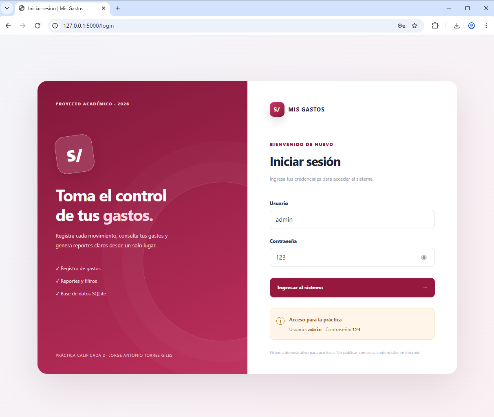
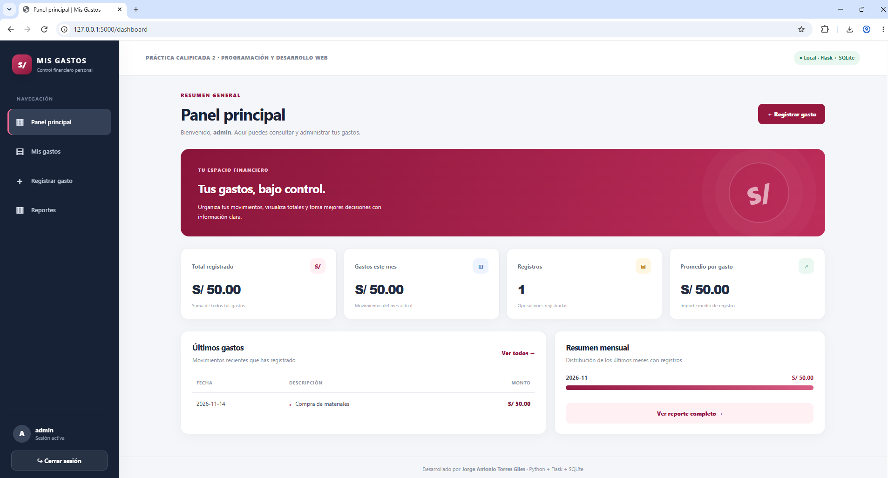
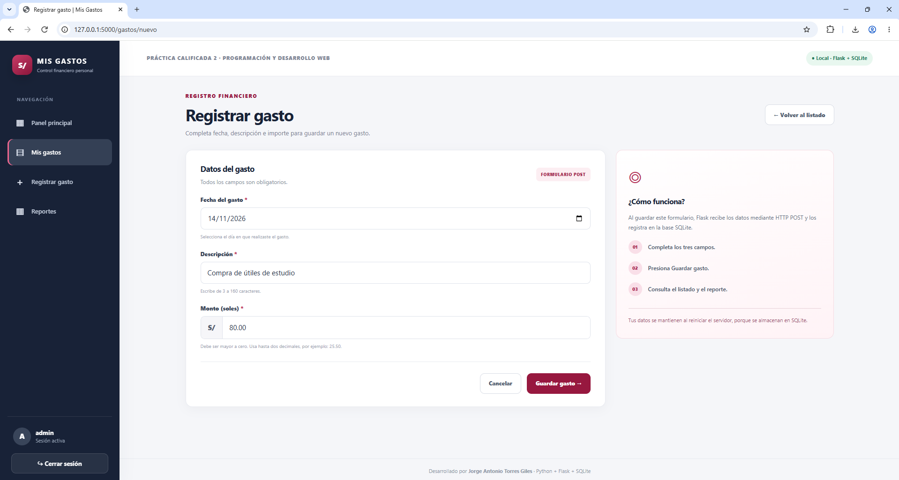
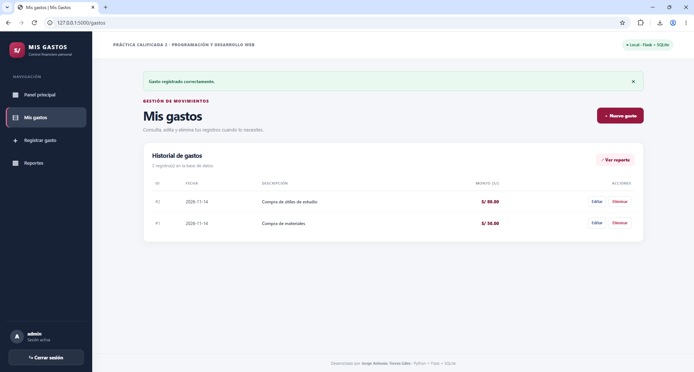
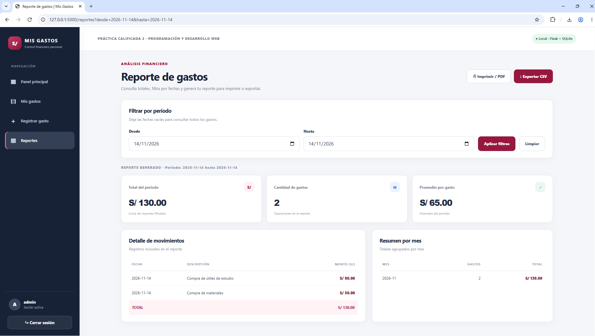

# Sistema Web de Control de Gastos

**Práctica Calificada 2 — Programación y Desarrollo Web**  
**Alumno:** Jorge Antonio Torres Giles  
**Carrera:** Ingeniería de Sistemas e Inteligencia Artificial

## Descripción

Aplicación web desarrollada con **Python, Flask y SQLite** para registrar gastos (fecha, descripción y monto), consultar el historial y generar reportes. Los datos se conservan en una base de datos local.

## Funcionalidades

- Inicio y cierre de sesión.
- Registro, edición y eliminación de gastos.
- Panel con resumen de importes.
- Reportes con filtros por fecha, impresión y exportación CSV.

## Cómo ejecutar desde la terminal de VS Code

Abre esta carpeta en Visual Studio Code y ejecuta los siguientes comandos en la terminal de **Windows (PowerShell)**:

```powershell
python -m venv .venv
.\.venv\Scripts\python.exe -m pip install -r requirements.txt
.\.venv\Scripts\python.exe app.py
```

Abre **http://127.0.0.1:5000** en el navegador.

**Credenciales para la práctica:** usuario `admin` · contraseña `123`.

## Funcionamiento

Iniciar sesión, seleccionar **Registrar gasto**, completar la fecha, descripción y monto y pulsar **Guardar**. Consultar los registros en **Mis gastos** y revisar los totales o filtra por fechas en **Reportes**.

## Capturas de pantalla

### 1. Inicio de sesión


### 2. Panel principal


### 3. Registro de un gasto


### 4. Historial de gastos


### 5. Reporte de gastos

